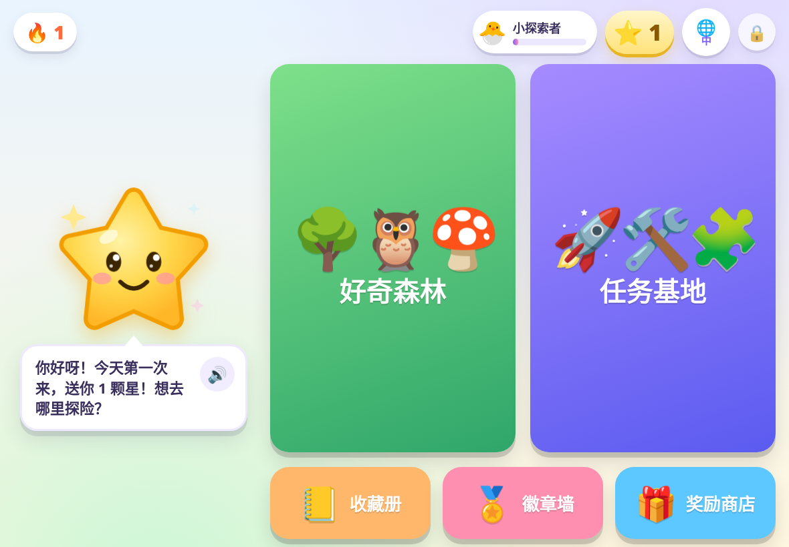
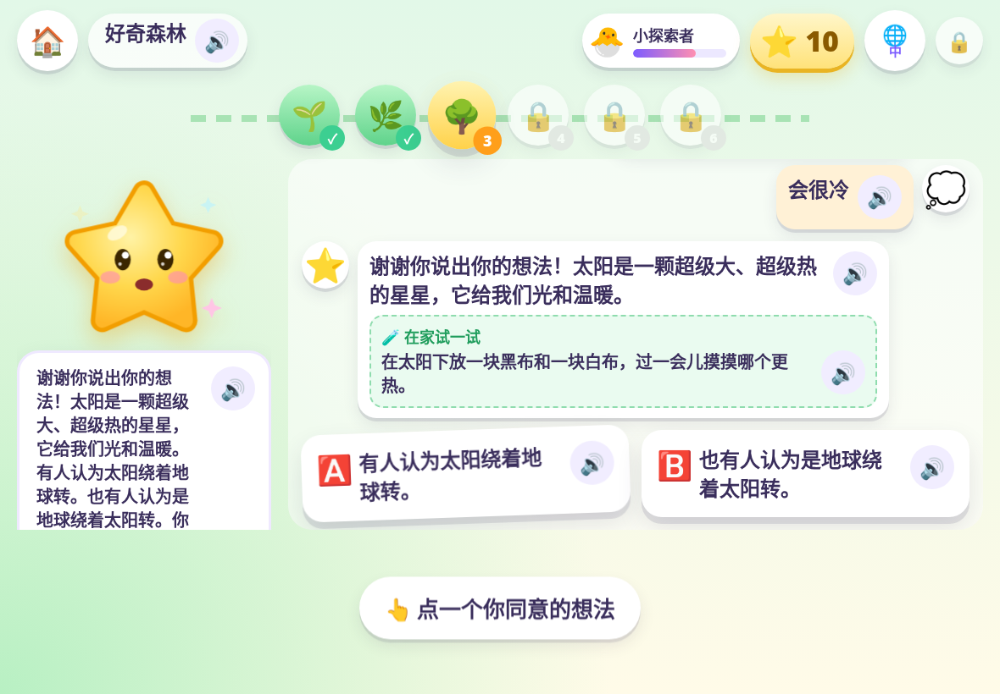
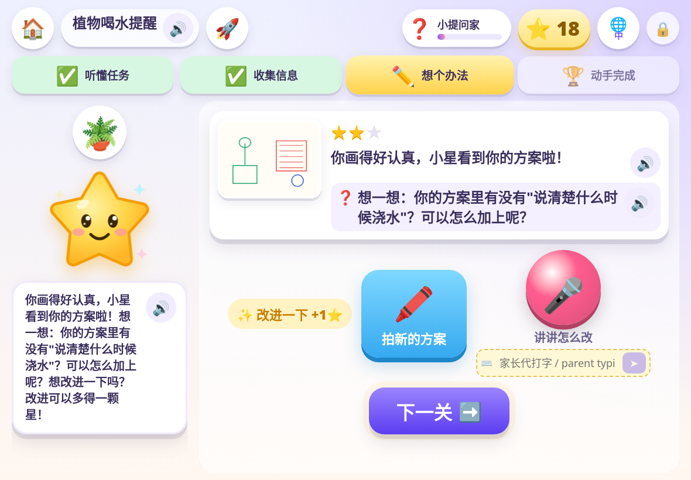
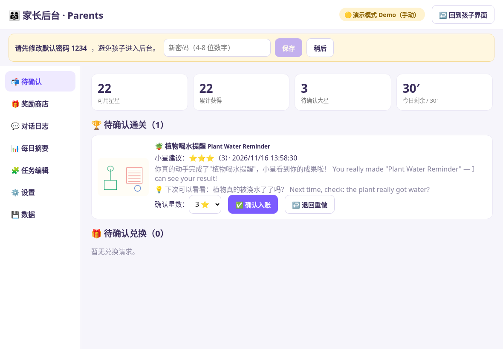

# ⭐ AI for Future · 未来小创想家

一个给 5 岁半小朋友的双语（中文 / English）AI 学习游戏：学会**提问**、学会**辩证思考**、学会**解决问题**。
不教识字——界面以图标、语音和动画为主，每段文字都有 🔊 朗读按钮，输入靠**按住说话**和**拍照**。

**在线地址：<https://larrydingatcy.github.io/ai-for-future/>**

| 模块 | 玩法 |
| --- | --- |
| 🌳 **好奇森林**（AI 问答） | 按住话筒提问 → 小星先问"你觉得呢？" → 简短回答 + 一个在家能试的小办法。每个问题即时评分（是什么 / 为什么 / 怎么做 / 如果…会怎样 / 真的吗，1–3⭐）。约 1/3 的回答给出"有人认为…也有人认为…"，让孩子选择并说理由。6 个关卡线性解锁。 |
| 🚀 **任务基地**（任务闯关） | 小星按难度自适应推荐任务并语音发布。每个任务 4 关：① 听懂任务（复述）② 收集信息卡（问小星 / 问家人 / 观察 / 拍照，每张 +1⭐）③ 画方案拍照或讲出来（视觉模型点评，改进一次 +1⭐）④ 动手完成、拍成果照、三句反思。通关大星 1–3 颗进入"待家长确认"。 |
| 🎁 激励 | 星星动画 + 合成音效 + 小星鼓掌；等级称号 小探索者 → 小提问家 → 小侦探 → 小发明家 → 未来创想家；徽章墙、信息卡收藏册、每日首次 +1、连续 7 天 +5；奖励商店（家长确认后才扣星）。 |
| 👨‍👩‍👧 家长后台 | 长按右上角 🔒 1.5 秒 + 密码（默认 `1234`，首次进入会提示修改）。待确认通关、奖励商店、兑换记录、对话日志（含照片）、每日摘要、任务编辑与 AI 生成审核、系统提示词、模型 / 语言 / 语音 / 时长设置、数据备份导入导出。 |

| 首页 | 好奇森林 |
| --- | --- |
|  |  |
| **任务第 3 关：方案点评** | **家长后台** |
|  |  |

所有数据（星星、对话、照片）**只保存在这台设备的浏览器里**（IndexedDB），不会上传到任何服务器。

---

## 1. 在 iPad 上打开

1. 用 iPad 的 **Safari** 打开 <https://larrydingatcy.github.io/ai-for-future/>
2. 点底部 **分享按钮 → 添加到主屏幕**。之后从主屏幕图标打开就是全屏 App（横屏体验最好）。
3. 点大大的 ▶ 开始（iOS 必须先点一下才能发声）。
4. 第一次按话筒时允许**麦克风**和**语音识别**权限。如果识别不可用：iPad 设置 → Siri 与搜索 / Safari → 麦克风 中打开；或在家长后台 → 设置 打开"家长代打字"。

**不接任何 AI 也能玩**：连不上模型时会自动进入**演示模式**（内置的小星脚本、关键词问题分类、规则评分），整个流程都能走通。家长后台顶部会显示当前是 🟢 AI 模式还是 🟡 演示模式（孩子界面不显示）。

## 2. 接入真正的 AI 模型

家长后台 → ⚙️ 设置 → AI 模型，填写 OpenAI 兼容接口：

| 字段 | 默认值 |
| --- | --- |
| base_url | `http://localhost:11434/v1`（Ollama） |
| API Key | 可选（Ollama 不需要） |
| 文本模型 | `qwen3` |
| 视觉模型 | `qwen2.5vl` |

改 base_url 和模型名就能切换模型，点"测试连接"会列出服务器上的模型。

### ⚠️ 重要限制：HTTPS 页面不能访问 http:// 的局域网 Ollama

GitHub Pages 是 **HTTPS**。iPad Safari 会拦截 HTTPS 页面去请求 `http://192.168.x.x:11434` 这样的地址（"混合内容"），而且 Ollama 默认也不允许别的网站跨域访问（CORS）。所以要从 iPad 上的 GitHub Pages 版本用你 Mac 上的 Ollama，有三种办法：

**方案 A：把 Ollama 用 HTTPS 暴露出来（推荐，数据仍在自己家里）**

```bash
# 1) 允许本网站跨域访问 Ollama（macOS 上 Ollama 是 App 时用 launchctl）
launchctl setenv OLLAMA_ORIGINS "https://larrydingatcy.github.io"
# 然后退出并重新打开 Ollama.app（命令行运行时：OLLAMA_ORIGINS=https://larrydingatcy.github.io ollama serve）

# 2a) Tailscale（iPad 和 Mac 都登录同一个 tailnet）
tailscale serve --bg 11434
#    → base_url 填 https://<你的mac名>.<tailnet>.ts.net/v1

# 2b) 或者 Cloudflare Tunnel
cloudflared tunnel --url http://localhost:11434
#    → base_url 填 https://xxxx.trycloudflare.com/v1
#    （公开隧道任何人都能访问，建议加 Cloudflare Access 或只临时使用）
```

**方案 B：用云端 OpenAI 兼容 API**：在设置里填它的 base_url、API Key 和模型名（文本模型 + 支持图片的视觉模型）。注意：此时孩子的问题和照片会发送给该服务商。

**方案 C：在 Mac 上本地运行（http，局域网使用）**

```bash
npm ci
NEXT_PUBLIC_BASE_PATH= npm run build      # 构建到 out/，根路径
npx serve out -l 3000                      # 或任何静态服务器
# iPad 打开 http://<Mac的IP>:3000/ ，base_url 填 http://<Mac的IP>:11434/v1
# 并设置 OLLAMA_ORIGINS="http://<Mac的IP>:3000"、OLLAMA_HOST=0.0.0.0
```

> 注意：在 http 页面下 iPad Safari 可能不允许麦克风 / 语音识别（需要安全上下文），这时请用"家长代打字"，或用方案 A。

### 拉取模型

```bash
ollama pull qwen3        # 文本：问答、评分、任务生成
ollama pull qwen2.5vl    # 视觉：看孩子画的方案和成果照片
```

qwen3 会自动加 `/no_think` 关闭思考过程，回答更快；即使模型输出了 `<think>…</think>` 也会被过滤。

### 语音识别（可选 whisper.cpp）

默认用浏览器自带的语音识别（iPad Safari 支持中文和英文）。如需本地 whisper：

```bash
git clone https://github.com/ggml-org/whisper.cpp && cd whisper.cpp
cmake -B build && cmake --build build -j --config Release
sh ./models/download-ggml-model.sh small        # 中文建议 small 或更大
./build/bin/whisper-server -m models/ggml-small.bin --host 0.0.0.0 --port 8080 --convert
#   --convert 需要安装 ffmpeg（brew install ffmpeg），用来转换 Safari 录的 m4a/webm
```

家长后台 → 设置 → 语音识别 选 "whisper.cpp server"，地址填 `https://…/inference`（同样需要 HTTPS，比如 `tailscale serve --bg --https=8443 8080`）。
也支持任何 OpenAI 兼容的 `/audio/transcriptions`。

## 3. 新增任务和关卡（改 JSON 即可）

- **任务**：编辑 [`content/missions.json`](content/missions.json)，推送到 main 后自动重新部署。字段：

  ```jsonc
  {
    "id": "paper-boat",            // 唯一 id（小写-连字符）
    "icon": "⛵",
    "title_zh": "会漂的纸船", "title_en": "Floating Paper Boat",
    "brief_zh": "……（会被朗读）", "brief_en": "……",
    "difficulty": 2,               // 1-3，用于自适应推荐
    "unlock_requires": ["plant-water"],   // 需要先完成（家长确认）的任务
    "understand_check": [{ "zh": "…", "en": "…" }],  // 复述时要说到的核心要点
    "info_hints": [{ "zh": "…", "en": "…" }],        // 收集信息的提示
    "plan_rubric": [{ "zh": "…", "en": "…" }],       // 方案评分标准
    "result_rubric": [{ "zh": "…", "en": "…" }],     // 成果评分标准（儿童语言）
    "reflection_prompts": [{ "zh": "什么做得好？", "en": "What went well?" }],
    "est_minutes": 20
  }
  ```

- **也可以在家长后台添加**：🧩 任务编辑 → 手动新建（JSON 编辑器），或输入主题让 AI 按模板生成，生成的任务进入"待审核"，批准后才出现在孩子的任务基地。后台的修改只保存在当前设备。
- **好奇森林关卡**：编辑 [`content/forest-levels.json`](content/forest-levels.json)。规则类型：`first_question`、`ask_type`（`qtype`: what / why / how / whatif / really）、`follow_up_streak`（`count`）、`challenge_with_reason`、`compare_choose`；`reward_stars` 是过关奖励。

## 4. 开发

```bash
npm ci
npm run dev          # http://localhost:3000/ai-for-future/
npm test             # vitest：星星账本、打卡、等级、关卡解锁、兑换、LLM 输出解析……
npm run build        # 静态导出到 out/
npm run serve        # 按 GitHub Pages 的路径在本地预览 out/
npm run e2e          # Playwright 冒烟测试（演示模式，需先 build + serve）
```

- 部署：`.github/workflows/deploy.yml` 在推送到 `main` 时测试、构建并发布到 GitHub Pages（Settings → Pages → Source 选 GitHub Actions）。`NEXT_PUBLIC_BASE_PATH` 自动设为 `/<仓库名>`。
- 代码结构：
  - `src/lib/logic/` 纯函数规则（账本、打卡、等级、森林关卡、任务推荐、问题分类、安全词、LLM 输出解析）——都有单元测试
  - `src/lib/services/game.ts` 所有状态变更的唯一入口
  - `src/lib/data/` 存储接口 `Repo` + IndexedDB（Dexie）实现；以后换服务器数据库只需实现同一接口
  - `src/lib/ai/` OpenAI 兼容客户端、小星提示词、演示模式知识库、每个评估的 LLM / 离线双实现
  - `src/lib/speech/` TTS（speechSynthesis）和 STT（Web Speech / whisper），可替换
  - `src/components/` 界面：小星 SVG 形象、按住说话、拍照、星星爆发动画、各页面和家长后台

## 小星的规则（默认系统提示词，可在后台修改）

每次最多 3 句、用 5 岁孩子懂的词、具体地夸奖；不直接给答案，多反问；不确定就说"我们一起查一查"；火、电、刀、药品要提醒"找大人"；被问到时诚实说自己是电脑程序；不输出任何链接。
无论提示词怎么改，应用都会在客户端**强制**：删除链接、截断到 3 句、检测危险话题并加上"找大人"提醒，并在日志和每日摘要里标记 ⚠️。

---

## English (short)

**AI for Future** is a bilingual (Chinese/English) learning game for a 5½-year-old: ask good questions in the **Curious Forest**, and solve real-world home missions in the **Mission Base** (understand → gather info cards → plan with a drawing → build, photo & reflect). Everything is voice-, icon- and animation-first, every text can be read aloud, and all data stays on the device (IndexedDB).

- **Play:** open <https://larrydingatcy.github.io/ai-for-future/> in iPad Safari → Share → *Add to Home Screen*. Works with zero setup in a built-in **demo mode**.
- **Parents:** long-press the 🔒 icon (1.5 s), PIN `1234` (you will be asked to change it).
- **Real AI:** Parent → Settings → base_url / model (OpenAI-compatible; default Ollama `qwen3` + `qwen2.5vl`). Because the site is HTTPS, a plain `http://` LAN Ollama is blocked by Safari (mixed content) — expose Ollama over HTTPS (`tailscale serve` / `cloudflared`) and set `OLLAMA_ORIGINS=https://larrydingatcy.github.io`, or use a cloud OpenAI-compatible key, or serve the static build locally over http.
- **Content:** add missions in `content/missions.json` and forest levels in `content/forest-levels.json`; push to `main` to redeploy.
- **Dev:** `npm ci && npm test && npm run build && npm run serve && npm run e2e`.
